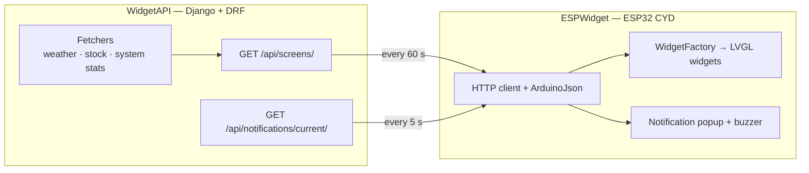

# SelfWidget — Server-Driven ESP32 Touch Display

A desk display built on an **ESP32 "Cheap Yellow Display" (CYD)** whose screen layout is defined by a backend, not hard-coded in firmware. A Django REST API describes screens and widgets (weather, stock, system stats) as JSON; the ESP32 fetches that description and builds the UI with LVGL.

**Status:** Working prototype (11.2025). Personal project. *Last updated: 10.2026*

---

## Architecture



- **Server-driven UI:** adding or rearranging a widget is a backend change (Django admin), no re-flash needed.
- **Strategy-based fetchers:** each widget type has its own data provider, registered by slug.

## Features

**Firmware (`ESPWidget/`, PlatformIO, C++)**
- ILI9341 320×240 SPI display with LVGL 8.3, XPT2046 resistive touch
- Builds widgets from JSON into a 2×2 grid per screen
- Periodic refresh: widget data every 60 s, lightweight notification check every 5 s
- Notification modal on top of all screens, with buzzer tone (LEDC PWM)
- Turkish-character font, placeholder UI on Wi-Fi / API failure, unknown-widget fallback

**Backend (`WidgetAPI/`, Django + DRF)**
- Models: widget types, screens, widget instances, device settings
- Widget types: `weather-card`, `stock-card`, `system-stats`
- Seed command for sample data, Django admin for configuration, optional Redis cache

## Limitations

- Device settings (poll interval, brightness) are defined in the backend but not yet applied on the device
- Touch uses a fixed calibration mapping
- No authentication on the API (intended for a local network)

## Run

**Backend**
```bash
pip install -r requirements.txt
cd WidgetAPI
python manage.py migrate
python manage.py seed_widgets   # optional sample data
python manage.py runserver 0.0.0.0:8000
```

**Firmware**
1. Create `ESPWidget/include/config/wifi_config.h` with `WIFI_SSID`, `WIFI_PASS` and `API_BASE_URL` (not committed).
2. Build and upload with PlatformIO: `pio run -t upload`

See [`ESPWidget/README.md`](ESPWidget/README.md) and [`WidgetAPI/README.md`](WidgetAPI/README.md) for details.

---

<sub>Türkçe: Ekran düzeni backend tarafından JSON olarak tanımlanan, ESP32 CYD üzerinde LVGL ile çalışan dokunmatik masaüstü ekran. Widget verisi 60 sn'de bir, bildirimler 5 sn'de bir güncelleniyor.</sub>
